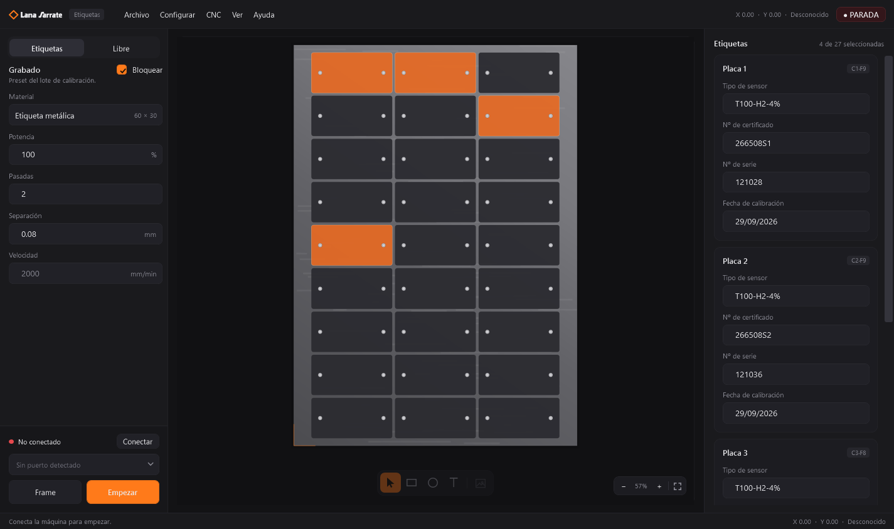
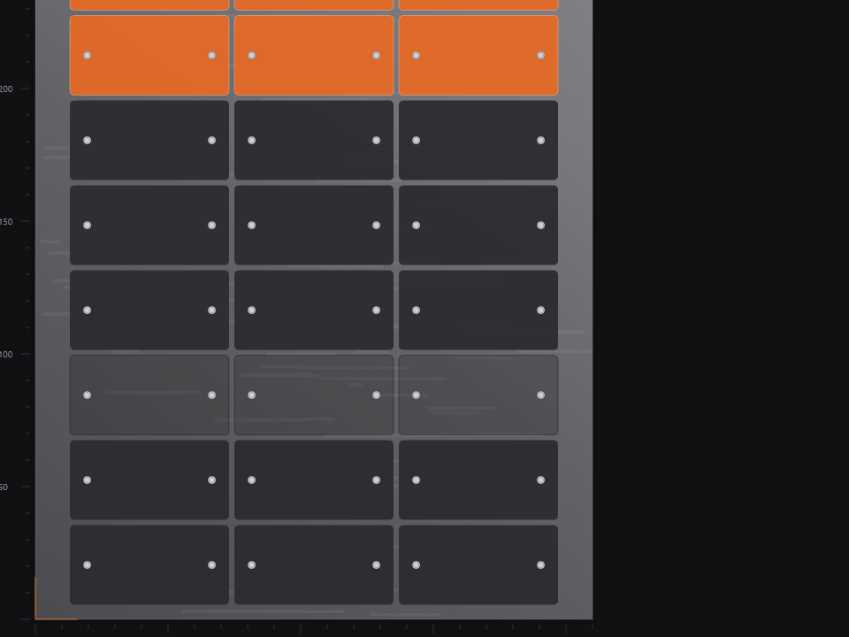
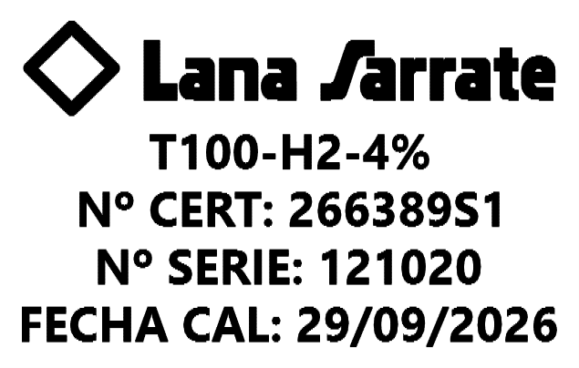
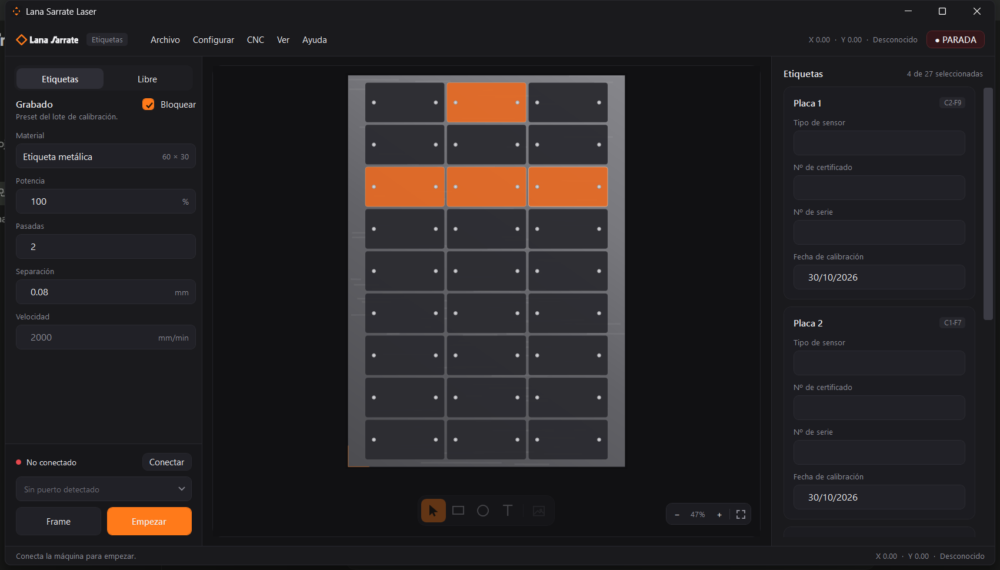
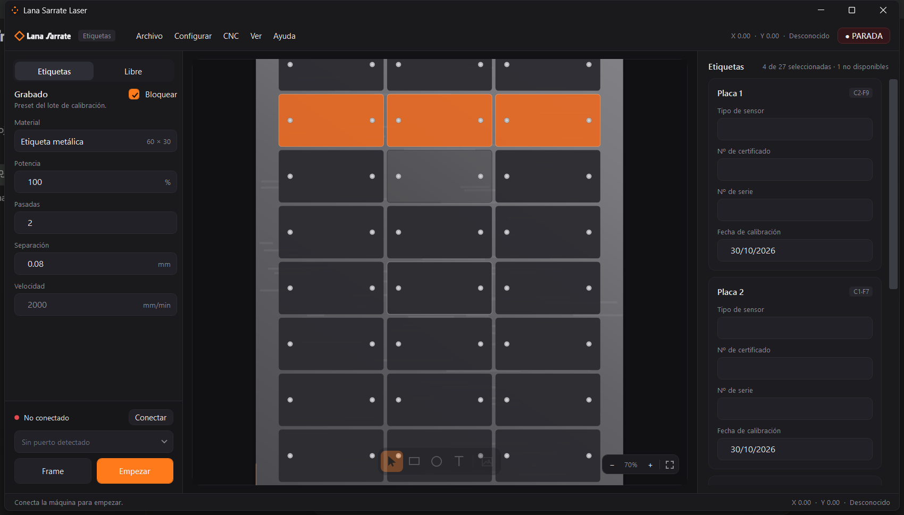

# Lana Sarrate Laser

Aplicación de escritorio nativa para **Windows** que opera una **Sculpfun S9** de forma
segura y guiada, pensada para personal no técnico. Graba certificados de calibración
sobre una plancha metálica A4 con rejilla fija de 3×9 celdas (27 etiquetas de 60×30 mm).

## Descargar

**[⬇ LanaSarrateLaser-Setup-1.15.2.exe](https://github.com/adriahermoso/lslaser/releases/latest/download/LanaSarrateLaser-Setup-1.15.2.exe)**

Windows 10/11 de 64 bits. El instalador **no necesita .NET instalado**: la aplicación va
autocontenida. Ejecuta el `.exe`, sigue el asistente y abre «Lana Sarrate» desde el menú
de inicio o el acceso directo del escritorio.

El instalador se comprueba a sí mismo al arrancar (CRC); si la descarga se cortó, avisa
con «Installer integrity check has failed» antes de tocar nada, en vez de instalar a medias.

## Qué hace

- **Marcar la plancha**: un clic en cada hueco del lienzo elige la celda; arrastrar marca
  varias de una pasada y el clic derecho aparta una celda (deja ver el metal).
- **Rellenar una tarjeta por celda** con tipo de sensor, nº de certificado, nº de serie y
  fecha de calibración. El autocompletado deduce los valores siguientes del patrón de los
  dos anteriores (el lote comparte numeración y fecha) y se detiene en cuanto el patrón se
  rompe, listo para escribir a mano.
- **Grabar el lote de forma secuencial** sobre el motor GRBL, por USB (115200 baudios).
- **Un solo botón para la máquina**: en reposo es `Frame` (comprueba el encuadre con el
  láser apagado) y durante el trabajo pasa a `Stop` (parada real: feed-hold, puerta de
  seguridad de GRBL y reset del firmware).

El grabado es **vectorial, no raster**: cada trazo del SVG se recorre como una fresa CNC
(`G0` hasta el inicio del trazo, `G1` sobre cada punto, `M4 S…` / `M5` por pasada), así que
la etiqueta conserva la geometría y la precisión del original. El texto se convierte en
contornos con la fuente del sistema, de modo que el láser no depende de tipografías
instaladas.

Coste medido por etiqueta: **2,42 m de trazo · 1,2 min por pasada a 2000 mm/min**.

## Interfaz

- **Panel derecho**: todo lo que afecta a la máquina — material, potencia, pasadas,
  separación, grabado del contorno y, abajo, conexión, `Frame` y `Empezar`.
- **Centro**: la plancha metálica con sus 27 huecos. Naranja para lo que se va a grabar,
  gris oscuro para lo que conserva etiqueta.
- **Panel izquierdo**: las tarjetas de las celdas marcadas, con los prefijos ya escritos
  («Nº CERT: », «Nº SERIE: », «FECHA CAL: »).
- **Barra inferior**: estado de la máquina a la izquierda y posición a la derecha.
- Ventana nativa de Windows (snap, sombras, Alt+Espacio), tema oscuro, DPI por monitor y
  gestos de trackpad: dos dedos desplazan, pinza hace zoom anclado al cursor.
- Atajos: `Ctrl+A` marcar todas las celdas, `Esc` limpiar la selección, `F1` guía rápida.

| Arrastre sobre la plancha | Pinza con el trackpad |
|---|---|
|  |  |

## Seguridad

La confirmación de **gafas de protección** es obligatoria en cada encendido, antes de que
la aplicación deje conectar con la máquina. El software no puede verificar que se lleven
puestas: la responsabilidad es de quien opera.

Primer trabajo recomendado: el `Frame` y una sola celda, con la plancha de prueba.

## Configuración

Se guarda en `%APPDATA%\LanaSarrateLaser\settings.json`: preset de chapa (2000 mm/min,
100 % de potencia, 2 pasadas, 0,08 mm de separación), geometría de la plancha, potencia y
velocidad del frame y puerto preferido. **El estado de la plancha no se guarda**: cada
sesión empieza con las 27 celdas disponibles.

## Estado

La aplicación, el motor GRBL (streaming, pausa y parada de emergencia) y la interfaz están
terminados y validados contra un emulador GRBL. **El grabado sobre la S9 real está
pendiente de probar**: conviene un primer lote de una sola celda.
